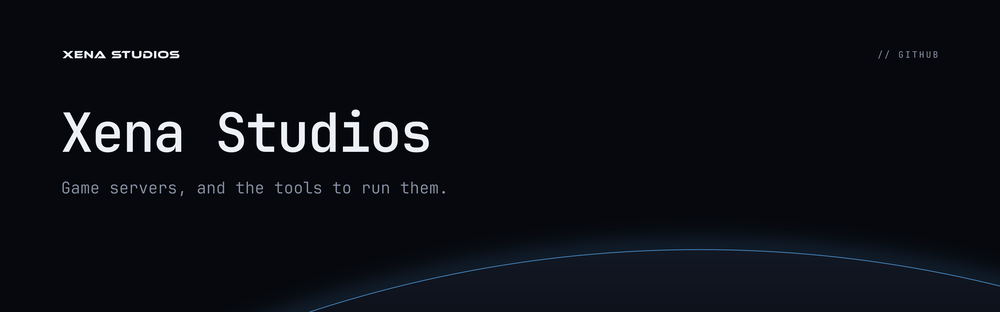

**Game servers, and the tools to run them.**

The [Xena Studios](https://xenastudios.co) organisation profile, and the defaults every repo shares.

| File | What it is |
|---|---|
| [`profile/README.md`](profile/README.md) | The profile shown at [github.com/xena-studios](https://github.com/xena-studios) |
| [`renovate-config.json`](renovate-config.json) | Renovate settings every repo extends |
| [`SECURITY.md`](SECURITY.md), [`CONTRIBUTING.md`](CONTRIBUTING.md), [`SUPPORT.md`](SUPPORT.md), [`CODE_OF_CONDUCT.md`](CODE_OF_CONDUCT.md) | Community files for every repo without its own |
| [Issue forms](.github/ISSUE_TEMPLATE), [PR template](.github/pull_request_template.md) | The same, for issues and pull requests |

## Making changes

- Changes go through pull requests, and the `check` job has to pass. It validates the Renovate configs, since a mistake there stops Renovate across the org.
- Commits follow [Conventional Commits](https://www.conventionalcommits.org): `docs:`, `build:`, `ci:`.
- `renovate-config.json` is extended by every repo, so check a change is safe for all of them.
- The community files and issue forms are the defaults for every repo without its own, so they have to read right for each of them.
- Images (the banner and everything in `profile/assets/`) are made in [xena-studios/brand](https://github.com/xena-studios/brand). Change them there, then copy them in. The profile copy follows [xenastudios.co](https://xenastudios.co).

## Licence

The profile and its images are © Xena Studios, all rights reserved. The code of conduct is the [Contributor Covenant](https://www.contributor-covenant.org) 2.1, under [CC BY 4.0](https://creativecommons.org/licenses/by/4.0/).
