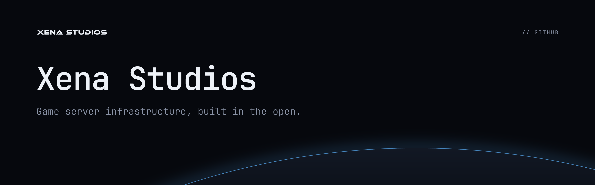

**Game server infrastructure, built in the open.**

This repository holds the [Xena Studios](https://xenastudios.co) organisation profile shown at [github.com/xena-studios](https://github.com/xena-studios).

- [`profile/README.md`](profile/README.md): the profile page.
- [`profile/assets/`](profile/assets): its header, product logos and plugin icons, generated in [xena-studios/brand](https://github.com/xena-studios/brand), not drawn here.
- [`renovate-config.json`](renovate-config.json): the Renovate settings every repository extends. [`check.yml`](.github/workflows/check.yml) validates it on every pull request, since a mistake in it would stop Renovate across the org.
- The default community files, which GitHub uses in every repository that doesn't have its own: [`SECURITY.md`](SECURITY.md), [`CODE_OF_CONDUCT.md`](CODE_OF_CONDUCT.md) (Contributor Covenant 2.1), [`CONTRIBUTING.md`](CONTRIBUTING.md) and [`SUPPORT.md`](SUPPORT.md).

The banner above is `github/dotgithub-banner.png` from the brand repo.

## Changes

`main` takes changes only through pull requests, and the `check` job has to pass. Commit messages follow [Conventional Commits](https://www.conventionalcommits.org) (`docs:`, `build:`, `ci:`). The profile's images come from the brand repo: change them there, then copy them in.

## Licence

The profile, its images and the banner are © Xena Studios, all rights reserved. [`CODE_OF_CONDUCT.md`](CODE_OF_CONDUCT.md) is the [Contributor Covenant](https://www.contributor-covenant.org) 2.1, under [CC BY 4.0](https://creativecommons.org/licenses/by/4.0/).
