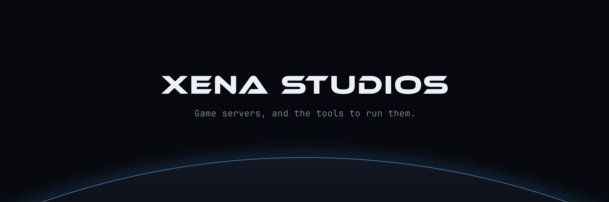
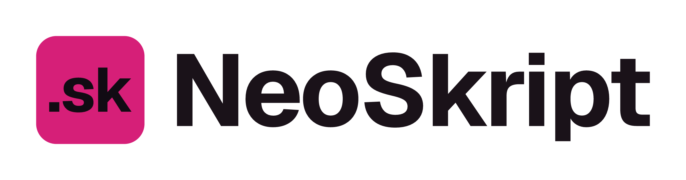
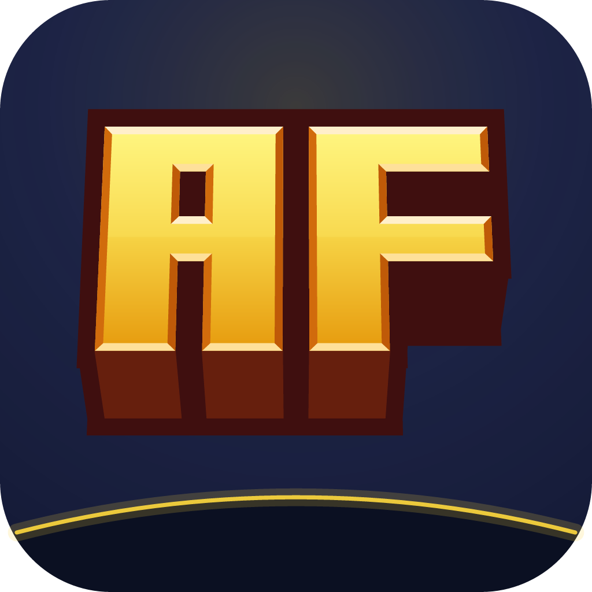
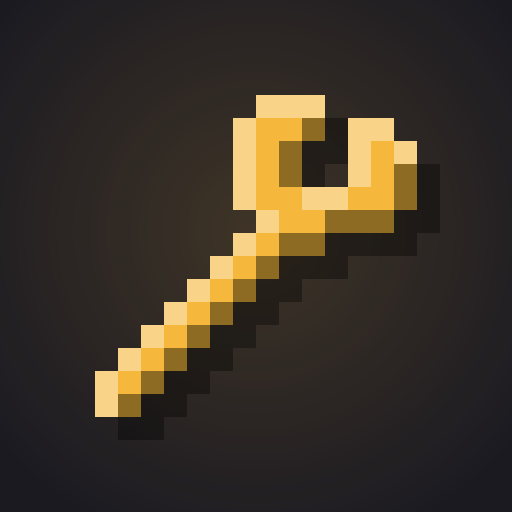
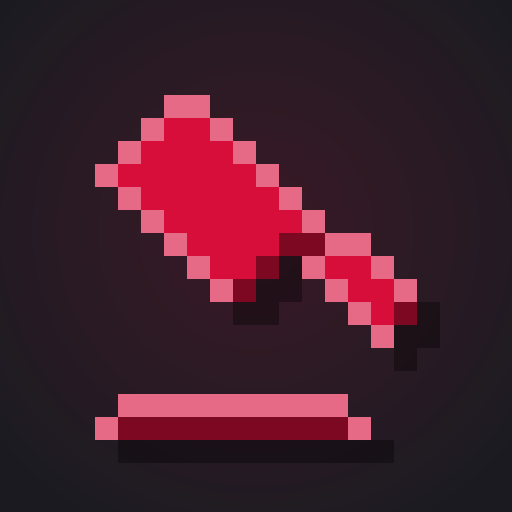
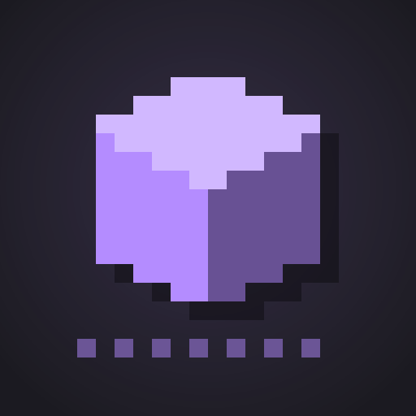
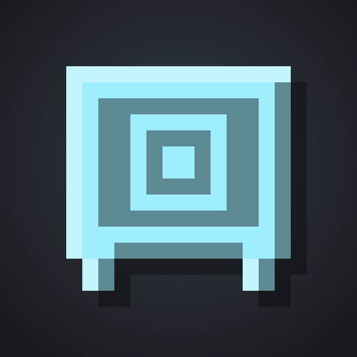

We build tools for running game servers on your own hardware, the Minecraft plugins that run on them, and Minecraft servers of our own. The tools and plugins are open source.

## Raptor

<picture>
  <source media="(prefers-color-scheme: dark)" srcset="assets/raptor-logo-dark.png">
  
</picture>

**Your machine. Every game.**

Run one install command on any Linux box you own or rent, then pick from 350+ games and apps and manage them from the web, with no panel to host. Plugins, mods, modpacks, the Steam Workshop, encrypted backups and databases are built in, and Pterodactyl eggs work as they are.

[Website](https://raptorpanel.net) · [Docs](https://docs.raptorpanel.net) · [Source](https://github.com/xena-studios/raptor) · AGPL-3.0

## NeoSkript

<picture>
  <source media="(prefers-color-scheme: dark)" srcset="assets/neoskript-logo-dark.png">
  
</picture>

**Keep your scripts. Lose the lag.**

A fast, modern drop-in replacement for Skript. Your `.sk` scripts run unchanged, only faster, on Paper and Folia. In public beta.

[Website](https://neoskript.dev) · [Docs](https://neoskript.dev/docs) · [Modrinth](https://modrinth.com/plugin/neoskript) · [Source](https://github.com/xena-studios/neoskript) · GPL-3.0-only

## Servers

Our own Minecraft servers, on Java and Bedrock. Both are in development.

| | Server | | |
|---|---|---|---|
|  | **MostWanted** | Cops vs. prisoners on Java & Bedrock. | [Website](https://mostwantedmc.com) |
|  | **Airfields** | Sky-mining PvP on Java & Bedrock. | [Website](https://airfieldsmc.com) |

## Plugins

Small plugins for Paper and Folia servers. Each does one job, costs next to nothing to run, and lets you switch off what you don't use.

| | Plugin | | |
|---|---|---|---|
|  | **xUtilities** | Every command you need. None you don't. | [Docs](https://plugins.xenastudios.co/xutilities/) · [Modrinth](https://modrinth.com/plugin/xutilities) |
|  | **zChat** | Format your chat. Keep it clean. | [Docs](https://plugins.xenastudios.co/zchat/) · [Modrinth](https://modrinth.com/plugin/zchat) |
|  | **xTeleport** | Every teleport your server needs. | [Docs](https://plugins.xenastudios.co/xteleport/) · [Download](https://plugins.xenastudios.co/xteleport/download/) |
|  | **xStats** | Every player's stats, on your own website. | [Docs](https://plugins.xenastudios.co/xstats/) · [Download](https://plugins.xenastudios.co/xstats/download/) |
|  | **xRewind** | Every change, logged. Any of it, undone. | [Docs](https://plugins.xenastudios.co/xrewind/) · [Download](https://plugins.xenastudios.co/xrewind/download/) |
|  | **xBans** | Bans, mutes and warnings. Nothing slips through. | [Docs](https://plugins.xenastudios.co/xbans/) · [Download](https://plugins.xenastudios.co/xbans/download/) |
|  | **xPlots** | Rentable plots, set up in a minute. | [Docs](https://plugins.xenastudios.co/xplots/) · [Download](https://plugins.xenastudios.co/xplots/download/) |
|  | **xVote** | Votes in. Rewards out. | [Docs](https://plugins.xenastudios.co/xvote/) · [Download](https://plugins.xenastudios.co/xvote/download/) |
|  | **xMoney** | The economy and Vault, in one plugin. | [Docs](https://plugins.xenastudios.co/xmoney/) · [Download](https://plugins.xenastudios.co/xmoney/download/) |
|  | **xLimbo** | Never drop a player again. | [Docs](https://plugins.xenastudios.co/xlimbo/) · [Modrinth](https://modrinth.com/plugin/xlimbo) |
|  | **xBackup** | Backups that cost nothing. Restores you can trust. | [Docs](https://plugins.xenastudios.co/xbackup/) · [Download](https://plugins.xenastudios.co/xbackup/download/) |

[Docs](https://plugins.xenastudios.co) · [Modrinth](https://modrinth.com/organization/xena-studios) · [Source](https://github.com/xena-studios/plugins) · GPL-3.0-only

---

[xenastudios.co](https://xenastudios.co) · Logos and press kit at [brand.xenastudios.co](https://brand.xenastudios.co) · [contact@xenastudios.co](mailto:contact@xenastudios.co)
