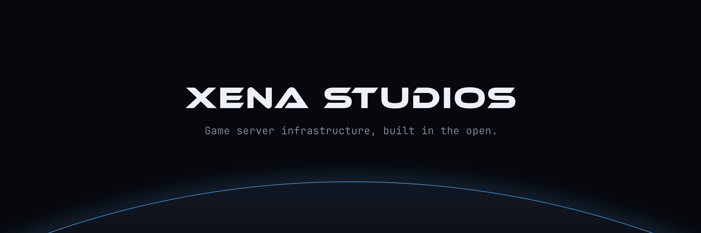
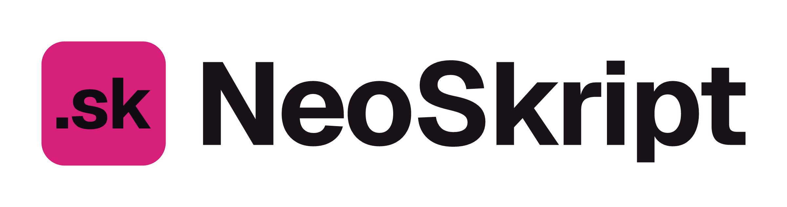
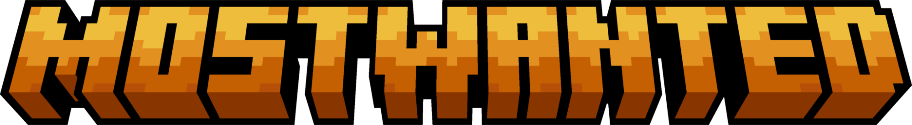
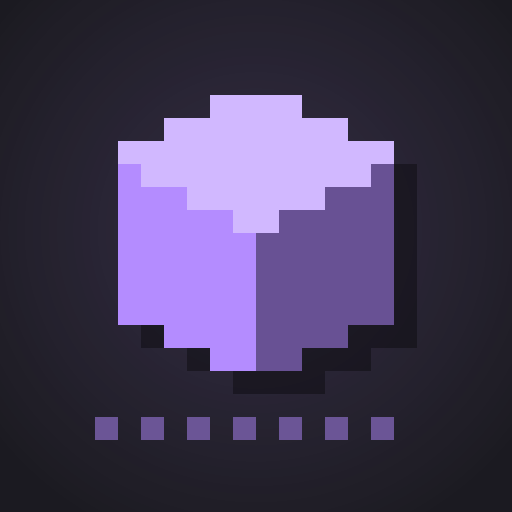

We build infrastructure for running game servers on your own hardware, the Minecraft plugins that run on them, and a Minecraft server of our own. All of it in the open.

## Raptor

<picture>
  <source media="(prefers-color-scheme: dark)" srcset="assets/raptor-logo-dark.png">
  
</picture>

**Pterodactyl had a good run.**

Raptor does everything you run Pterodactyl for, with the add-ons built in and no panel to host. Run one install command on a dedicated server, a VPS or a spare box at home, then create and manage game servers, Discord bots and voice servers from the web panel.

- **Panel**: the hosted web app at [raptorpanel.net](https://raptorpanel.net).
- **Wings**: the daemon on your machine. It keeps your servers running even when the Panel can't be reached.
- **`raptor` CLI**: status, power, console, logs, backups and restores, and `doctor`, which says what's wrong and how to fix it, right on the box.
- Compatible with Pterodactyl and Pelican eggs, and `raptor import pterodactyl` moves existing servers over.

[Website](https://raptorpanel.net) · [Docs](https://docs.raptorpanel.net) · [Source](https://github.com/xena-studios/raptor) · AGPL-3.0

## NeoSkript

<picture>
  <source media="(prefers-color-scheme: dark)" srcset="assets/neoskript-logo-dark.png">
  
</picture>

**Keep your scripts. Lose the lag.**

NeoSkript is a fast, modern drop-in replacement for Skript. Your `.sk` scripts run unchanged, only faster, on Paper and Folia.

In development, not released yet.

[Source](https://github.com/xena-studios/neoskript) · GPL-3.0-or-later

## MostWanted

**Cops vs. prisoners on Java & Bedrock.**

MostWanted is our own Jailbreak-style Minecraft server. Prisoners break out and rob the town; guards, picked by application, bring them back. One world that keeps running, on our own plugins.

In development, not open yet.

[Source](https://github.com/xena-studios/mostwanted) · GPL-3.0-only

## Plugins

Small plugins for Paper servers. Each one does one job, costs next to nothing to run, and lets you switch off anything you don't use.

| | Plugin | | |
|---|---|---|---|
|  | **xUtilities** | Every command you need. None you don't. Gamemodes, flight, heal, `/back`, workstation menus, and link commands like `/discord` that you write yourself. Every command can be switched off. Paper and Folia. | [Docs](https://docs.xenastudios.co/xutilities/) · [Modrinth](https://modrinth.com/plugin/xutilities) |
|  | **zChat** | Format your chat. Keep it clean. A chat format per rank, a filter that's hard to dodge, cooldowns, mentions and private messages. Each message is drawn once, however many players see it. Paper and Folia. | [Docs](https://docs.xenastudios.co/zchat/) · [Modrinth](https://modrinth.com/plugin/zchat) |
|  | **xLimbo** | Never drop a player again. Your network's fallback server: when the main server goes down, players wait in a safe void world instead of being disconnected, and go back when it's up. Paper. | [Docs](https://docs.xenastudios.co/xlimbo/) · [Modrinth](https://modrinth.com/plugin/xlimbo) |

[Docs](https://docs.xenastudios.co) · [Modrinth](https://modrinth.com/organization/xena-studios) · [Source](https://github.com/xena-studios/plugins) · GPL-3.0-only

## Contact

[xenastudios.co](https://xenastudios.co) · [contact@xenastudios.co](mailto:contact@xenastudios.co)
