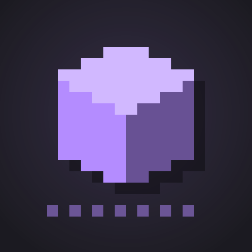

We build tools for running game servers on your own hardware, the Minecraft plugins that run on them, and a Minecraft server of our own. All in the open.

## Raptor

<picture>
  <source media="(prefers-color-scheme: dark)" srcset="assets/raptor-logo-dark.png">
  
</picture>

**Pterodactyl had a good run.**

Everything you run Pterodactyl for, with the add-ons built in and no panel to host. Run one install command on any Linux box, then manage your game servers, Discord bots and voice servers from the web. Pterodactyl and Pelican eggs work as they are.

[Website](https://raptorpanel.net) · [Docs](https://docs.raptorpanel.net) · [Source](https://github.com/xena-studios/raptor) · AGPL-3.0

## NeoSkript

<picture>
  <source media="(prefers-color-scheme: dark)" srcset="assets/neoskript-logo-dark.png">
  
</picture>

**Keep your scripts. Lose the lag.**

A fast, modern drop-in replacement for Skript. Your `.sk` scripts run unchanged, only faster, on Paper and Folia. In development.

[Source](https://github.com/xena-studios/neoskript) · GPL-3.0-or-later

## MostWanted

**Cops vs. prisoners on Java & Bedrock.**

Our own Jailbreak-style Minecraft server. Prisoners break out and rob the town; guards bring them back. In development.

[Source](https://github.com/xena-studios/mostwanted) · GPL-3.0-only

## Plugins

Small plugins for Paper servers. Each does one job, costs next to nothing to run, and lets you switch off what you don't use.

| | Plugin | | |
|---|---|---|---|
|  | **xUtilities** | Every command you need. None you don't. | [Docs](https://docs.xenastudios.co/xutilities/) · [Modrinth](https://modrinth.com/plugin/xutilities) |
|  | **zChat** | Format your chat. Keep it clean. | [Docs](https://docs.xenastudios.co/zchat/) · [Modrinth](https://modrinth.com/plugin/zchat) |
|  | **xLimbo** | Never drop a player again. | [Docs](https://docs.xenastudios.co/xlimbo/) · [Modrinth](https://modrinth.com/plugin/xlimbo) |

[Docs](https://docs.xenastudios.co) · [Modrinth](https://modrinth.com/organization/xena-studios) · [Source](https://github.com/xena-studios/plugins) · GPL-3.0-only

## Contact

[xenastudios.co](https://xenastudios.co) · [contact@xenastudios.co](mailto:contact@xenastudios.co)
